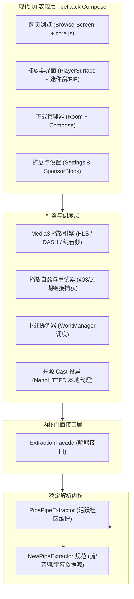
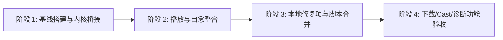

# Litube 架构现代化与内核融合迁移计划

> [!NOTE]
> **目标**：以稳定高效的成熟内核（**PipePipeExtractor**）为核心，吸收上游 Litube 3.0.x 的现代 Android 架构（Kotlin + Jetpack Compose + Media3 + Room + WorkManager），打造兼具「高可用免维护内核」与「现代轻量 UI 体验」的播放器。

---

## 一、 方案选型与技术路线对比

当前仓库处于原 Java + XML 架构（分支 `PipepipeExtractor`），而上游已经完成了一次彻底的 Compose 纯 Kotlin 重写（3.0.3）。我们面临两种重构路线：

| 维度 | 路线 A：在现有 Java 代码上反向移植功能 | 路线 B（推荐）：基于 v3.0 基线换装 PipePipeExtractor |
| :--- | :--- | :--- |
| **工作模式** | 将上游的 Compose、Media3、Room 等逐个翻译/反向嫁接到旧 Java/XML 架构 | 以 upstream/master (3.0.3) 为基线，替换其脆弱的自研 Extractor，接入成熟的 PipePipeExtractor 并移植本地修复项 |
| **架构现代化** | 极低（依然受旧生命周期、XML 布局、Hilt/手写依赖管理束缚） | 极高（纯 Kotlin、Jetpack Compose、Koin、Coroutines/Flow、Room） |
| **开发工作量** | 巨大且冗余（需在旧 Java 项目中配置 Compose 混编、手工实现 WorkManager 下载调度等） | 聚焦核心（仅需适配 `Extractor` 接口层与迁移本地 Web 脚本/UI 修复） |
| **后续上游同步** | 几乎无法再同步任何上游 UI 与新特性 | 架构完全对齐，后续上游的 UI 优化与小特性可轻松 cherry-pick |
| **内核稳定性** | 极佳（继续使用 PipePipeExtractor） | 极佳（剥离上游自研 Solver，换上成熟内核） |

> [!TIP]
> **推荐结论（路线 B）**：在全新的 `feat/v3-pipepipe` 分支上，以 upstream 3.0.3 为基线代码。上游虽然自己写 Solver/Extractor 支持慢且经常 403，但其 **Compose UI、开源 Cast、Room 下载管线、Media3 封装** 架构非常轻量现代。我们通过统一的**内核门面（Extractor Facade）**接入 PipePipeExtractor，既规避了上游内核脆弱的致命伤，又白赚了一套现代 Compose 架构。

---

## 二、 目标融合架构设计

---

## 三、 分阶段实施路线图

### 阶段 1：基线搭建与内核门面适配 (Phase 1)
1. **新建迁移分支**：基于 `upstream/master` (3.0.3) 建立新分支 `feat/v3-pipepipe`。
2. **替换依赖配置**：
   - 移除 `com.github.HydeYYHH:NewPipeExtractor`。
   - 引入成熟的 `com.github.InfinityLoop1308:PipePipeExtractor:586325e`（或最新 release）。
   - 保留 AndroidX Media3、Koin、Compose、Room、WorkManager 依赖配置。
3. **内核门面接口抽象（Facade Pattern）**：
   - 上游 3.0 中的 `Extractor.kt`、`HttpDownloader.kt` 深度绑定了其自研的 `AndroidChallengeSolver` 和 `RemoteEjsRuntime`。
   - 将其重构为轻量门面类 `ExtractorEngine`，直接由 `PipePipeExtractor` 接管 `StreamInfo`、`AudioStream`、`VideoStream`、`SubtitleStream` 的提取。
   - 彻底移除容易失效的本地 JS Solver 编译与复杂 challenge 逻辑。

### 阶段 2：Media3 播放引擎与自愈整合 (Phase 2)
1. **流格式映射**：
   - 将 PipePipeExtractor 返回的流对象（DASH MPD、HLS m3u8、独立视频流、高码率音频流）适配到 Media3 的 `MediaSourceResolver`。
2. **保留上游优秀机制：自愈状态机 (`PlaybackRecovery.kt`)**：
   - 当 YouTube 触发网络变动、流地址短暂失效时，由自愈器触发内核刷新，自动平滑续播。
3. **音轨与画质控制**：
   - 接入原生多音轨切换（HLS 多语言音轨和 YouTube 原始音轨匹配）。
   - 启用 Media3 的纯音频后台播放、锁屏控制器与 PiP 远程控制动作。

### 阶段 3：本地业务逻辑与 Web 脚本合并 (Phase 3)
对比我们本地在旧版本修复的关键体验，移植到 3.0 的对应模块：
1. **Watch 页面优化与重载处理**：
   - 移植我们在 `watch_autoreload.js`、`init.js` 中调整的重载逻辑到上游新的 `core.js` 统一脚本运行时。
2. **UI 与全屏修复**：
   - 将全屏旋转切换、状态栏沉浸、字幕记忆（`Remember last subtitle language`）移植到 Compose 的 `PlayerControls` 和 `SubtitleSelection` 中。
3. **扩展配置项保留**：
   - 将已有的偏好设置项与上游新增的 SponsorBlock 独立细分开关、JSON 设置备份/恢复进行合并。

### 阶段 4：下载、Cast 投屏与诊断系统验收 (Phase 4)
1. **Room + WorkManager 下载管线联调**：
   - 验证 PipePipeExtractor 的视频/音频分段下载在 `DownloadBatchExecutor` 中的断点续传与媒体合并（MediaMuxer）。
   - 验证播放列表批量下载。
2. **开源 Cast 投屏验证**：
   - 验证无 Google Play 服务的设备上，基于本地 NanoHTTPD 代理对局域网 Chromecast 设备的投屏可用性。
3. **应用内诊断系统 (Diagnostics)**：
   - 保留一键导出诊断包功能，方便后续用户遇到个别极端视频无法播放时导出日志排查。

---

## 四、 核心技术难点与避坑策略

> [!WARNING]
> 1. **流签名与解密 (n-sig / PoToken)**:
>    上游 3.0 维护了一个庞大的 `RemoteEjsRuntime` 和 `AndroidChallengeSolver`，代码量大且易随 YouTube 前端更新失效；而 PipePipeExtractor 内部已内聚处理了该逻辑。迁移时应**直接砍掉上游自研 Solver 代码**，全面委托给 PipePipeExtractor，避免双重逻辑冲突。
> 2. **Compose 状态与 WebView 原生混合层的生命周期**:
>    上游为了避免 WebView 在后台空闲时定时器空转耗电，增加了 `AndroidWebViewTimerClock`。在接入我们自定义的 watch 注入脚本时，必须保持与这个休眠时钟协同，不能破坏后台暂停机制。
> 3. **Room 数据库版本兼容**:
>    如果本地用户原本在旧版中有历史记录或下载记录，需要注意旧版的 MMKV / SQLite 存储迁移到 Room 数据库的数据结构兼容。
