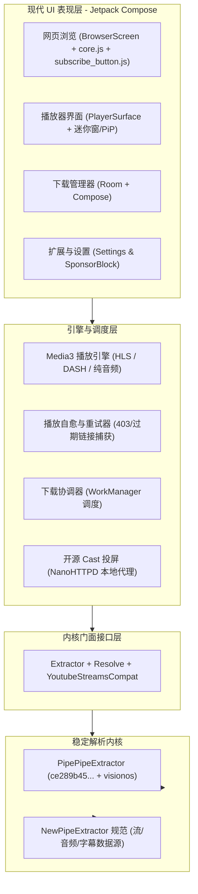

# Litube 架构现代化与内核融合迁移计划

> [!NOTE]
> **目标**：以稳定高效的成熟内核（**PipePipeExtractor** `ce289b45503e06ae5e578ea70c92bc87d21b3a73`）为核心，吸收上游 Litube 3.0.x 的现代 Android 架构（Kotlin + Jetpack Compose + Media3 + Room + WorkManager），打造兼具「高可用免维护内核」与「现代轻量 UI 体验」的播放器。

---

## 一、 方案选型与技术路线对比

当前仓库原处于 Java + XML 架构（分支 `PipepipeExtractor`），而上游完成了一次彻底的 Compose 纯 Kotlin 重写（3.0.3）。我们采用 **路线 B（基于 v3.0 基线换装 PipePipeExtractor）**：

| 维度 | 路线 A：在现有 Java 代码上反向移植功能 | 路线 B（已采用）：基于 v3.0 基线换装 PipePipeExtractor |
| :--- | :--- | :--- |
| **工作模式** | 将上游的 Compose、Media3、Room 等逐个翻译/反向嫁接到旧 Java/XML 架构 | 以 `upstream/master` (3.0.3) 为基线，替换其脆弱的自研 Extractor，接入成熟的 PipePipeExtractor 并移植本地修复项 |
| **架构现代化** | 极低（受旧生命周期、XML 布局束缚） | 极高（纯 Kotlin、Jetpack Compose、Koin、Coroutines/Flow、Room） |
| **开发工作量** | 巨大且冗余 | 聚焦核心（适配 `Extractor` 接口层与迁移本地 Web 脚本/导航修复） |
| **后续上游同步** | 难以同步上游 UI 与新特性 | 架构完全对齐，后续上游的 UI 优化与小特性可轻松 cherry-pick |
| **内核稳定性** | 极佳（继续使用 PipePipeExtractor） | 极佳（剥离上游自研 Solver，换上成熟内核 `visionos` 客户端） |

---

## 二、 目标融合架构设计

---

## 三、 五步迁移执行记录（全部完成 ✅）

- [x] **Step 1：依赖配置升级 (`libs.versions.toml`)**
  - 将 `newpipe-extractor` 替换为 `com.github.InfinityLoop1308:PipePipeExtractor:ce289b45503e06ae5e578ea70c92bc87d21b3a73`。
- [x] **Step 2：Web 脚本增强移植 (`subscribe_button.js` & `WebViewFactory.kt`)**
  - 新增 `app/src/main/assets/script/subscribe_button.js`（清理冗余频道徽章、调整订阅按钮展示、修复纯数字显示为「已订阅」）。
  - 在 `WebViewFactory.kt` 注册注入顺序。
- [x] **Step 3：核心解析层换装与冗余清理 (`extractor/` & `di/`)**
  - 重构 `Extractor.kt`、`Resolve.kt`、`HttpDownloader.kt`、`YoutubeMediaRequests.kt`，通过 `NewPipe.init(downloader)` 与 `NewPipe.setYoutubePlayerClient("visionos")` 驱动提取。
  - 彻底移除上游自研的 `AndroidChallengeSolver`、`RemoteEjsRuntime`、`JavascriptRuntime`、`PoTokenProvider`、`AdaptiveClientOrder`、`BrowserPlayerResponses`、`YoutubeExtractionHost`、`YoutubeSessionProvider`、`MediaCookieIdentity` 以及 `assets/ejs`、`assets/potoken`。
- [x] **Step 4：页面跳转与迷你窗状态同步优化 (`BrowserViewModel` & `PlayerViewModel`)**
  - 区分非 Watch 页跳转与同页刷新，跨页导航时自动收起全屏播放为迷你窗（`minimize()`），点击相同视频时直接展开已有播放会话（`expand()`），并补充单元测试 `BrowserViewModelTest.kt`。
- [x] **Step 5：兼容层补齐与全量符号检查 (`YoutubeStreamsCompat.kt` 等)**
  - 新增 `org.schabi.newpipe.extractor.services.youtube.streams.YoutubeStreamsCompat.kt`，提供轻量兼容模型（`ClientProfile`、`FormatKey`、`StreamDemand`、`YoutubeSession`、`RequestPlan`、`ExtractionContext`、`StreamHttpException`），使 Media3 播放、缓存、下载、诊断模块与 `PipePipeExtractor` 无缝衔接。
  - 在 `Models.kt` 补齐 `ByteArray.hexString()` 扩展，在 `YoutubePlaybackCacheKey.kt` 完善无 `resourceIdentity` 时的 `ofQuery` 缓存键回退，在 `androidTest` 补齐 `ExtractionTestActivity.kt`。
